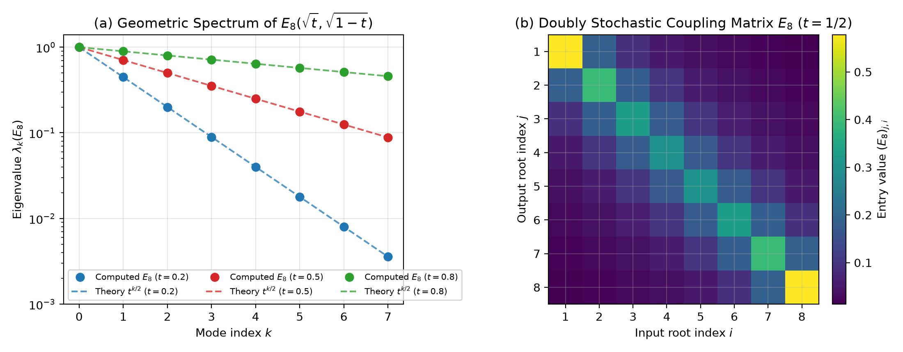
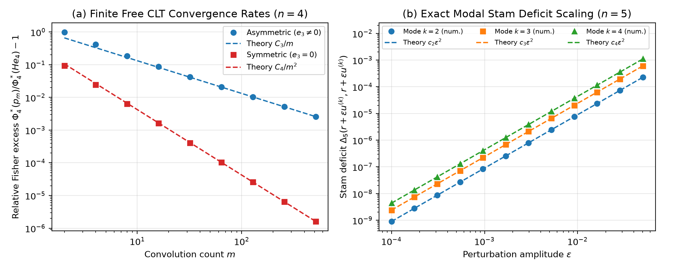

# Quantitative Stability, Exact CLT Asymptotics, and $\ell^p$-Stam Inequalities in Finite Free Information Theory

**Author:** Tristan Schubert  
**Status:** AI-assisted working draft (directed and computationally verified by the named author; independent verification by a human specialist in finite free probability is welcomed — see the Provenance and AI-Assistance Disclosure below).  
**Companion files:** [`paper.tex`](paper.tex) (LaTeX manuscript), [`verify_theorems.py`](verify_theorems.py) (50-digit `mpmath`, exact $\mathbb{Q}$, and numerical verification suite)

---

## Abstract

We study quantitative stability, finite free central limit asymptotics, and $\ell^p$-generalizations of the finite free Stam inequality around the Hermite extremizer of finite free additive convolution $\boxplus_n$, building on recent work of Garza-Vargas–Srivastava–Stier (`arXiv:2602.15822`), Hashemi (`arXiv:2604.11922`), and Hashemi–Hyun (`arXiv:2609.10367`). Our main results are threefold.

First, we compute the exact $2\times 2$ block-diagonal Hessian of the finite free Stam deficit $\Delta_n$ at every Hermite pair $(\sigma_1 r, \sigma_2 r)$, yielding the sharp $n$-independent *asymptotic* local stability constant $2t(1-t)$ relative to Cramér–Rao gaps ($c_n^{\mathrm{loc}} = 1/2$ for eq. (101) of `arXiv:2609.10367`, with degree-dependent neighborhoods and remainders). By contrast, an Appell backward-heat Euler operator proves algebraically that for every $n \ge 4$, literal $c_n = 1/2$ fails on every neighborhood of *every* Hermite pair $(\sigma_1 r, \sigma_2 r)$. Globally, an exact cubic discriminant identity strengthens $n=3$ to $\Delta_3 \ge 2t(1-t)(\delta_3(\alpha)+\delta_3(\beta))$, whereas for $n \ge 4$ we establish explicit upper-bound obstructions: colliding roots collapse the unnormalized constant to $0$, a Dyson-flow slope bound gives $c_n^{(101)} \le 2/n + O(n^{-2})$ (with exact rational quartic bound $c_4^{(101)} \le 876/1855$), and the first-order Dyson defect of the Jacobian contraction operator gives the exact error-term-free bound $c_n^{(100)} \le \frac{1}{n-1}$ for all $n \ge 3$ (sharpened via interval arithmetic to $c_4^{(100)} \le 0.314134 < \frac{1}{3}$). These constrain the decay rate of any degree-dependent constant $c_n > 0$ in Conjecture 8.1 of `arXiv:2609.10367`; whether the *optimal* global constants of eqs. (100) and (101) separate by a factor of $2$ remains open.

Second, we derive exact leading Fisher-information asymptotics for $m$-fold finite free CLT convergence ($m \to \infty$), prove parity vanishing of all half-integer powers of $m^{-1}$, and establish a universal two-term Edgeworth expansion up to $O(m^{-3})$ independent of $\gamma_5, \dots, \gamma_n$, identifying an open cone in $(\gamma_3, \gamma_4)$-space on which $R_n(p_m, p_m) < 1/2$ along the CLT tail.

Third, we prove a $3\times 3$ doubly stochastic $\ell^p(\mathbf{1}^\perp)$ contraction theorem via rank-$1$ Riesz–Thorin extensions, settling Conjecture 5.2 of `arXiv:2604.11922` for all real-rooted cubics and $p \in (1, 2]$. At $n = 4$ we prove an analytic obstruction for uniform rank-$1$ shifts, and at $n = 5$ we give an explicit interval-certified zero-residual dual obstruction ruling out any universal all-degree ambient linear-extension proof (without disproving Conjecture 5.2 itself), motivating an intrinsic quotient $\ell^q$ dual formulation.

---

## 1. Introduction and Main Contributions

Building on Garza-Vargas–Srivastava–Stier (`arXiv:2602.15822`), Hashemi (`arXiv:2604.11922`), and Hashemi–Hyun (`arXiv:2609.10367`), our main new results follow Sections 4–6:

1. **Exact Stam Deficit Hessian, All-Degree Local Non-Attainment, and Global Upper-Bound Obstructions** (Section 4: Theorems 4.1, 4.4, 4.6, and 4.8; Corollary 4.2; Propositions 4.5 and 4.7; Remarks 4.3 and 4.9).
2. **Exact Finite Free CLT Fisher-Information Asymptotics and Universal Two-Term Edgeworth Expansion** (Section 5: Theorem 5.1 and Corollary 5.2, complementing Arizmendi–Perales' 2020 root-distance Berry–Esseen bounds).
3. **Proof of Conjecture 5.2 of `arXiv:2604.11922` for $n=3$ and Degree-$5$ Ambient Linear-Extension Obstruction** (Section 6: Theorem 6.3 and Remark 6.4).

To keep the exposition self-contained, Section 3 collects brief rederivations of two known results from `arXiv:2609.10367` (Theorem A.1 and Theorem 5.1 / Appendix A), yielding the reversed-weight truncated Mehler sign law (Corollary 3.4), and Section 6 recalls Propositions 6.1–6.2 (`arXiv:2602.15822`, Lemma 3.2; `arXiv:2604.11922`, Proposition 5.5) before proving Theorem 6.3. Appendix A in [`paper.tex`](paper.tex) records the complete short integer/rational data for both interval-arithmetic certificates.

---

## 2. Preliminaries and Differential Representation

Let $\mathcal{P}_n$ be the set of monic polynomials of degree $n$ with simple real roots. For $p(x) = \prod_{i=1}^n (x - \alpha_i) = \sum_{k=0}^n (-1)^k a_k x^{n-k}$ and $q(x) = \prod_{j=1}^n (x - \beta_j) = \sum_{k=0}^n (-1)^k b_k x^{n-k}$, their **finite free additive convolution** (Marcus–Spielman–Srivastava, 2022) is
$$(p \boxplus_n q)(x) := \sum_{k=0}^n (-1)^k c_k x^{n-k}, \qquad c_k := \sum_{i+j=k} \frac{(n-i)!(n-j)!}{n!(n-k)!}\, a_i b_j.$$
For sorted root vectors $\alpha_1 < \dots < \alpha_n$ and $\beta_1 < \dots < \beta_n$, let $\Omega_{\boxplus_n}(\alpha, \beta) = \gamma = (\gamma_1, \dots, \gamma_n)$ denote the sorted root vector of $p_\alpha \boxplus_n p_\beta$.

Let $\mathbb{R}_n[x]$ denote the space of real polynomials of degree at most $n$. For any $p(x) = \sum_{k=0}^n (-1)^k a_k x^{n-k} \in \mathbb{R}_n[x]$, define the differential operator
$$\mathcal{D}_p(\partial_x) := \sum_{k=0}^n (-1)^k \frac{(n-k)!}{n!}\, a_k \partial_x^k.$$

### Lemma 2.1 (Differential Representation of $\boxplus_n$)
For all $p, q \in \mathbb{R}_n[x]$, $(p \boxplus_n q)(x) = \mathcal{D}_p(\partial_x) \mathcal{D}_q(\partial_x) x^n = \mathcal{D}_q(\partial_x) p(x) = \mathcal{D}_p(\partial_x) q(x)$.

*Proof.* Since $\partial_x^k x^n = \frac{n!}{(n-k)!} x^{n-k}$ for $k \le n$ and $0$ for $k > n$, $\mathcal{D}_p(\partial_x) x^n = p(x)$ and expanding $\mathcal{D}_p(\partial_x)\mathcal{D}_q(\partial_x) x^n$ matches the definition of $p \boxplus_n q$. Commutativity of constant-coefficient differential operators gives the remaining equalities. $\square$

### Lemma 2.2 (Heat Operator for Scaled Hermite Polynomials)
Let $He_n(x) = \sum_{m=0}^{\lfloor n/2 \rfloor} \frac{(-1)^m n!}{2^m m!(n-2m)!} x^{n-2m}$ be the probabilist's Hermite polynomial with roots $r_1 < \dots < r_n$, and set $h^{(\sigma)}(x) := \sigma^n He_n(x/\sigma)$ for $\sigma > 0$. Then $\mathcal{D}_{h^{(\sigma)}}(\partial_x)$ acts on $\mathbb{R}_n[x]$ identically to $\exp\big(-\frac{\sigma^2}{2}\partial_x^2\big)$. Consequently, for $m \in \{0, \dots, n\}$ and $\sigma = \sqrt{\sigma_1^2 + \sigma_2^2}$,
$$\exp\!\left(-\frac{\sigma_2^2}{2}\partial_x^2\right)\!\big[\sigma_1^m He_m(x/\sigma_1)\big] = \sigma^m He_m(x/\sigma).$$

*Proof.* In $h^{(\sigma)}$, $a_{2m} = (-1)^m \frac{n!}{2^m m!(n-2m)!}\sigma^{2m}$ and $a_{2m+1} = 0$, so $\mathcal{D}_{h^{(\sigma)}}(\partial_x) = \sum_{m=0}^{\lfloor n/2\rfloor} \frac{1}{m!}(-\frac{\sigma^2}{2}\partial_x^2)^m$, which agrees with $\exp(-\frac{\sigma^2}{2}\partial_x^2)$ on $\mathbb{R}_n[x]$. Applying $\exp(-\frac{\sigma_2^2}{2}\partial_x^2)$ to $\sigma_1^m He_m(x/\sigma_1) = \exp(-\frac{\sigma_1^2}{2}\partial_x^2) x^m$ gives $\exp(-\frac{\sigma^2}{2}\partial_x^2)x^m = \sigma^m He_m(x/\sigma)$. $\square$

---

## 3. Spectral Preliminaries and the Log-Gas Semigroup

### Lemma 3.1 (Orthonormal Hermite–Lagrange Basis)
For $n \ge 2$, define $u^{(k)} \in \mathbb{R}^n$ ($k = 0, 1, \dots, n-1$) by
$$u^{(k)}_i := \sqrt{\frac{n!}{(n-1-k)!}}\,\frac{He_{n-1-k}(r_i)}{He_n'(r_i)}, \qquad i = 1, \dots, n.$$
Then $\{u^{(0)}, \dots, u^{(n-1)}\}$ is an orthonormal basis of $\mathbb{R}^n$, with $u^{(0)} = \frac{1}{\sqrt{n}}\mathbf{1}$ and $u^{(1)} = \frac{1}{\sqrt{n(n-1)}} r$.

*Proof.* Setting $y = r_i$ in the Christoffel–Darboux formula for $He_m$ and using $He_n'(r_i) = n He_{n-1}(r_i)$ gives the expansion of the Lagrange polynomial $\ell_i(x) = \frac{He_n(x)}{(x - r_i)He_n'(r_i)} = \frac{n!}{[He_n'(r_i)]^2} \sum_{m=0}^{n-1} \frac{He_m(r_i)}{m!} He_m(x)$. Integrating $\ell_i(x) He_\ell(x)$ against $d\mu_G(x) = \frac{1}{\sqrt{2\pi}}e^{-x^2/2}\,dx$ and using $He_m(x) = \sum_{i=1}^n He_m(r_i)\ell_i(x)$ yields $\sum_{i=1}^n \frac{n!}{[He_n'(r_i)]^2} He_m(r_i) He_\ell(r_i) = m!\,\delta_{m,\ell}$ ($0 \le m,\ell \le n-1$), which is $\langle u^{(k)}, u^{(k')}\rangle = \delta_{k,k'}$. The formulas for $k=0,1$ follow from $He_n' = n He_{n-1}$ and $He_n(r_i) = r_i He_{n-1}(r_i) - (n-1)He_{n-2}(r_i) = 0$. $\square$

### Theorem 3.2 (Spectral Decomposition of $E_n(\sigma_1, \sigma_2)$; `arXiv:2609.10367`, Theorem A.1)
Let $n \ge 2$, $\sigma_1, \sigma_2 > 0$, $\sigma = \sqrt{\sigma_1^2 + \sigma_2^2}$, and $t = \sigma_1^2/\sigma^2 \in (0, 1)$. Then $E_n(\sigma_1, \sigma_2) := \frac{\partial \Omega_{\boxplus_n}(\cdot, \sigma_2 r)}{\partial \alpha}\big|_{\alpha=\sigma_1 r}$ is symmetric and positive definite with spectral decomposition
$$E_n(\sigma_1, \sigma_2) = \sum_{k=0}^{n-1} t^{k/2}\, u^{(k)} (u^{(k)})^T.$$
In particular, $\spec(E_n(\sigma_1, \sigma_2)|_{\mathbf{1}^\perp}) = \{t^{k/2} : k = 1, \dots, n-1\}$. Setting $\sigma_1 = \sigma_2$ ($t = 1/2$) gives $\{2^{-k/2} : k = 1, \dots, n-1\}$ (Conjecture 4.1 of Hashemi, 2026, and Theorem A.1 of Hashemi–Hyun, 2026).

*Proof.* Differentiating $(p_\alpha \boxplus_n h^{(\sigma_2)})(\gamma_j(\alpha)) = 0$ at $\alpha = \sigma_1 r$ via Lemmas 2.1 and 2.2, for any $v \in \mathbb{R}^n$, $w = E_n(\sigma_1,\sigma_2) v$ satisfies
$$w_j \sigma^{n-1} He_n'(r_j) = \left(\exp\!\left(-\frac{\sigma_2^2}{2}\partial_x^2\right) f_v\right)\!(\sigma r_j), \qquad f_v(x) := \sum_{i=1}^n v_i \frac{h^{(\sigma_1)}(x)}{x - \sigma_1 r_i}.$$
For $v = u^{(k)}$ ($m = n-1-k$), $f_v(\sigma_1 r_i) = \sqrt{\frac{n!}{m!}} \sigma_1^{n-1} He_m(r_i)$, so by degree-$(n-1)$ interpolation uniqueness $f_v(x) = \sqrt{\frac{n!}{m!}} \sigma_1^k [\sigma_1^m He_m(x/\sigma_1)]$. By Lemma 2.2, applying $\exp(-\frac{\sigma_2^2}{2}\partial_x^2)$ and evaluating at $\sigma r_j$ yields $w_j = (\sigma_1/\sigma)^k u^{(k)}_j = t^{k/2} u^{(k)}_j$. $\square$

### Theorem 3.3 (Log-Gas Laplacian Semigroup; `arXiv:2609.10367`, Theorem 5.1 & Appendix A)
Define the weighted graph Laplacian $L_n \in \mathbb{R}^{n\times n}$ on $\{r_1, \dots, r_n\}$ by $(L_n)_{j,i} = -\frac{2}{(r_j - r_i)^2}$ ($j \neq i$) and $(L_n)_{i,i} = \sum_{\ell \neq i} \frac{2}{(r_i - r_\ell)^2}$. Then:
1. $L_n u^{(k)} = k\,u^{(k)}$ for $k = 0, \dots, n-1$, and for $V_{\log}(x) = \frac{1}{2}\sum x_i^2 - \sum_{i<j}\ln|x_i-x_j|$ (whose equilibrium is $r/\sqrt{2}$, while $r$ is the equilibrium of $\frac{1}{4}\sum x_i^2 - \sum_{i<j}\ln|x_i-x_j|$), $\nabla^2 V_{\log}(r) = I + \frac{1}{2} L_n$.
2. $P_t := E_n(\sqrt{t}, \sqrt{1-t}) = t^{L_n/2} = \exp\big(\frac{\ln t}{2} L_n\big)$ forms a commuting symmetric Markov semigroup ($P_s P_t = P_{st}$). Hence $E_n(\sigma_1, \sigma_2)$ is doubly stochastic and entrywise strictly positive for all $\sigma_1, \sigma_2 > 0$ (recovering the Hermite case of `arXiv:2609.10367`, Theorem 5.1).

*Proof sketch.* Setting $t = 1 - \epsilon$ and differentiating at $\epsilon = 0$ gives $\frac{d}{d\epsilon}\big|_{\epsilon=0} P_{1-\epsilon} u^{(k)} = -\frac{k}{2} u^{(k)}$. Directly differentiating $\exp(-\frac{\epsilon}{2}\partial_x^2)[(1-\epsilon)^{\frac{n-1}{2}} \phi_i(x/\sqrt{1-\epsilon})]$ for $\phi_i(y) = \frac{He_n(y)}{y - r_i}$ at $\epsilon = 0$ and substituting $He_n(y) = (y - r_i)\phi_i(y)$ into the Hermite ODE yields $-\frac{1}{2}(L_n)_{j,i}$ for $j \neq i$, while symmetry of $P_{1-\epsilon}$ (Theorem 3.2) and $P_{1-\epsilon}\mathbf{1} = \mathbf{1}$ determine the diagonal. Strict entrywise positivity follows because $-L_n$ is a symmetric irreducible Metzler matrix with zero row sums. $\square$

### Corollary 3.4 (Dual Truncated Mehler Sign Law)
For every $n \ge 2$, $\rho \in (0, 1)$, and $i, j \in \{1, \dots, n\}$, $(P_{\rho^2})_{j,i} = \frac{n!}{He_n'(r_i) He_n'(r_j)} \sum_{m=0}^{n-1} \rho^{n-1-m} \frac{He_m(r_i) He_m(r_j)}{m!} > 0$. Hence the reversed-weight (dual) degree-$(n-1)$ truncated Mehler kernel $K_n(r_i, r_j; \rho) := \sum_{m=0}^{n-1} \rho^{n-1-m} \frac{He_m(r_i)He_m(r_j)}{m!} = \rho^{n-1} K_n^{\mathrm{std}}(r_i, r_j; \rho^{-1})$ has the same strict sign as $He_n'(r_i) He_n'(r_j)$ for every $\rho \in (0, 1)$.

*Remark 3.5.* Hashemi and Hyun (`arXiv:2609.10367`, Appendix A, eqs. (113)–(114)) obtained $E_{n;\tau,\sigma} = \exp(-A_n \log\frac{\tau+\sigma}{\tau})$ with $A_n = \frac{1}{2}L_n$ via the classical root spectrum of Sasaki (2015), and proved strict entrywise positivity of general one-sided Jacobians in `arXiv:2609.10367`, Theorem 5.1; the proof above derives $L_n u^{(k)} = k u^{(k)}$ directly from the Hermite ODE without external spectral results and yields Corollary 3.4 directly.

---

## 4. Exact Stam Deficit Hessian, Local Stability, and Global Obstructions

Let $s_i(\alpha) := \sum_{j \neq i} \frac{1}{\alpha_i - \alpha_j} = \frac{p_\alpha''(\alpha_i)}{2 p_\alpha'(\alpha_i)}$ and $\Phi_n^*(\alpha) := \|s(\alpha)\|_2^2$. At $r$, $s(r) = \frac{1}{2}r$ and $\Phi_n^*(r) = \frac{n(n-1)}{4}$. The finite free Stam deficit is
$$\Delta_n(\alpha, \beta) := \frac{1}{\Phi_n^*(\Omega_{\boxplus_n}(\alpha,\beta))} - \frac{1}{\Phi_n^*(\alpha)} - \frac{1}{\Phi_n^*(\beta)} \ge 0,$$
and the Cramér–Rao gap for centered $\alpha$ ($\sum \alpha_i = 0$) is $\delta_n(\alpha) := \frac{4\|\alpha\|_2^2}{[n(n-1)]^2} - \frac{1}{\Phi_n^*(\alpha)} \ge 0$.

### Theorem 4.1 (Exact Block-Diagonal Hessian of the Finite Free Stam Deficit)
For $n \ge 3$, $\sigma_1, \sigma_2 > 0$, $\sigma = \sqrt{\sigma_1^2 + \sigma_2^2}$, and $t = \sigma_1^2/\sigma^2$, expanding $u = \sum_{k=0}^{n-1} u_k u^{(k)}$ and $v = \sum_{k=0}^{n-1} v_k u^{(k)}$ gives
$$\Delta_n(\sigma_1 r + u, \sigma_2 r + v) = \frac{4}{[n(n-1)]^2} \sum_{k=2}^{n-1} (k+1)^2 \left[ u_k^2 + v_k^2 - \left(t^{k/2} u_k + (1-t)^{k/2} v_k\right)^2 \right] + O(\|u\|^3 + \|v\|^3).$$

*Proof summary.* The 4-dimensional affine symmetry space $\Span\{u^{(0)}, u^{(1)}\} \oplus \Span\{u^{(0)}, u^{(1)}\}$ lies in $\ker\nabla^2\Delta_n(\sigma_1 r, \sigma_2 r)$. On $\Span\{u^{(2)}, \dots, u^{(n-1)}\}$, differentiating $\langle x, s(x) \rangle \equiv \frac{n(n-1)}{2}$ twice at $x = \tau r$ yields $\langle r, \nabla^2 s(\tau r)[\eta, \eta]\rangle = \tau^{-3}\langle \eta, L_n \eta\rangle$, giving $\frac{1}{\Phi_n^*(\tau r + \eta)} = \frac{4\tau^2}{n(n-1)} - \frac{4}{[n(n-1)]^2}\sum_{k=2}^{n-1} k(k+2)\eta_k^2 + O(\|\eta\|^3)$. For $\gamma = \sigma r + w_1 + w_2 + O(3)$, Theorem 3.2 gives $w_1 = \sum_{k=2}^{n-1}(t^{k/2}u_k + (1-t)^{k/2}v_k)u^{(k)}$, while additivity of the second power sum gives $\langle r, w_2\rangle = \frac{\|u\|_2^2 + \|v\|_2^2 - \|w_1\|_2^2}{2\sigma}$. Combining these yields the $(k+1)^2 = 1 + k(k+2)$ block-diagonal quadratic form. $\square$

### Corollary 4.2 (Sharp $n$-Uniform Local Stability) and Remark 4.3
For $u, v \in \Span\{u^{(2)}, \dots, u^{(n-1)}\}$ with $\delta_n(\sigma_1 r + u) + \delta_n(\sigma_2 r + v) > 0$, as $(u, v) \to (0, 0)$,
$$\Delta_n(\sigma_1 r + u, \sigma_2 r + v) \ge \big(2t(1-t) - O_{n,\sigma_1,\sigma_2}(\|u\| + \|v\|)\big)\big(\delta_n(\sigma_1 r + u) + \delta_n(\sigma_2 r + v)\big),$$
and $2t(1-t)$ is asymptotically sharp uniformly in $n$ (attained at $k=2$, $(u_2, v_2) \propto (t, 1-t)$). For $\sigma_1 = \sigma_2$ and $u = v \to 0$, $\Delta_n(\sigma_1 r + u, \sigma_1 r + u) \ge (1 - O_{n,\sigma_1}(\|u\|))\delta_n(\sigma_1 r + u)$. Defining the colliding-root-renormalized relative Stam ratio
$$R_n(\alpha, \beta) := \frac{\Delta_n(\alpha, \beta) / \Phi_n^*(\gamma)^{-1}}{4t(1-t)\,(\delta_n(\alpha)+\delta_n(\beta))/(h_\alpha + h_\beta)}$$
(which coincides identically and globally with `arXiv:2609.10367`, eq. (101), so any global constant $c_n$ in Conjecture 8.1 / eqs. (100)–(101) satisfies $c_n \le \inf R_n$), Remark 4.3 establishes the sharp **asymptotic / infinitesimal** local constant $c_n^{\mathrm{loc}} = 1/2$ ($\liminf R_n = 1/2$ near every Hermite pair, while Theorem 3.2 gives eq. (100) with exact constant $1/2$ pointwise *at* $(\sigma_1 r, \sigma_2 r)$).

### Theorem 4.4 (All-Degree Local Non-Attainment of $c_n = 1/2$ at Every Hermite Pair for $n \ge 4$)
For every $n \ge 3$ and $\lambda \in \mathbb{R}$, define $p_{\varepsilon,\lambda}(x) := \mathcal{D}_{p_{\varepsilon,\lambda}}(\partial_x) x^n$ via $\mathcal{D}_{p_{\varepsilon,\lambda}}(z) := \exp(-\frac{1}{2}z^2 + \frac{\varepsilon}{6}z^3 + \frac{\lambda\varepsilon^2}{24}z^4) \pmod{z^{n+1}}$. For sufficiently small $\varepsilon > 0$, $p_{\varepsilon,\lambda} \in \mathcal{P}_n$ satisfies $(p_{\varepsilon,\lambda} \boxplus_n p_{\varepsilon,\lambda})(x) = 2^{n/2}\,p_{\varepsilon/\sqrt{2},\lambda}(x/\sqrt{2})$. Combining the backward heat-flow Euler score operator $s(\varepsilon,\mu) = (\frac{1}{2} - \frac{3}{2}\varepsilon\partial_\varepsilon - 2\mu\partial_\mu)\alpha(\varepsilon,\mu)$ with variance conservation and the truncation-free orthogonal polynomial basis $Q_{k+1}(x) = x Q_k(x) - (n-k+1)Q_{k-1}(x)$ ($\langle Q_j(r), Q_k(r)\rangle = (n)_j\delta_{j,k}$ with $Q_j(r_i) = 0$ for all $j > n$) proves algebraically for **every $n \ge 3$** that
$$g_n(\varepsilon) := 1 - \frac{\Phi_n^*(He_n)}{\Phi_n^*(p_{\varepsilon,\lambda})} = \frac{n-2}{4}\varepsilon^2 + \frac{(n-2)(n-3)}{36}\!\left[\Bigl(\lambda + \frac{15}{4}\Bigr)^2 - \frac{81}{16}\right]\varepsilon^4 + O(\varepsilon^6).$$
Minimizing at $\lambda^* = -\frac{15}{4}$ gives, for **every $n \ge 4$**,
$$R_n(p_\varepsilon, p_\varepsilon) = \frac{1}{2} + \frac{19 - 5n}{64}\,\varepsilon^2 + O(\varepsilon^4) < \frac{1}{2}, \qquad \frac{\Delta_n(p_\varepsilon, p_\varepsilon)}{2\delta_n(p_\varepsilon)} = \frac{1}{2} - \frac{9(n-3)}{64}\,\varepsilon^2 + O(\varepsilon^4) < \frac{1}{2}.$$
More generally, at **every** unequal-scale Hermite pair $(\sigma_1 r, \sigma_2 r)$ ($\sigma_1, \sigma_2 > 0$, $t = \sigma_1^2/(\sigma_1^2+\sigma_2^2)$, $\omega = t(1-t)$, $\theta = (1-2t)^2 \in [0, 1)$), the scaled pair $\alpha_\varepsilon := \sigma_1 p_{\sqrt{t}\,\varepsilon,-15/4}$, $\beta_\varepsilon := \sigma_2 p_{\sqrt{1-t}\,\varepsilon,-15/4}$ obeys $R_n(\alpha_\varepsilon, \beta_\varepsilon) = \frac{1}{2} + \frac{P_4(\theta) + (n-4)P_{\mathrm{slope}}(\theta)}{72(1-2\omega)}\varepsilon^2 + O(\varepsilon^4) < \frac{1}{2}$ with $P_4(\theta) \le -\frac{9}{32} < 0$ and $P_{\mathrm{slope}}(\theta) \le -\frac{45}{32} < 0$, proving that literal $c_n = 1/2$ fails on every neighborhood of every Hermite pair and $\inf R_n < \frac{1}{2}$ for all $n \ge 4$.

### Proposition 4.5 (Global Obstruction for Unnormalized Cramér–Rao Stability at $n \ge 4$)
For every $n \ge 4$, the unnormalized additive bound $\Delta_n(\alpha, \beta) \ge c_n \cdot 4t(1-t)(\delta_n(\alpha) + \delta_n(\beta))$ fails globally for every $c_n > 0$. Specifically, taking $p_\epsilon = q_\epsilon \in \mathcal{P}_n$ ($t = 1/2$) for sufficiently small $\epsilon > 0$ with $n-1$ roots $-1 + j\epsilon$ ($j=0,\dots,n-2$) and one isolated root $(n-1) - \frac{(n-1)(n-2)}{2}\epsilon$, as $\epsilon \to 0^+$ we have $p_\epsilon(x) \to p_0(x) = (x+1)^{n-1}(x - (n-1))$ and $\delta_n(p_\epsilon) \to \frac{4}{n(n-1)} > 0$. Yet $(p_0 \boxplus_n p_0)(x) = (x+2)^{n-2}\big((x+2)^2 - 2n(x+2) + n(n-1)\big)$ retains a root of multiplicity $n-2 \ge 2$ at $-2$, forcing $\Phi_n^*(p_\epsilon \boxplus_n p_\epsilon) \to \infty$ and hence $\Delta_n(p_\epsilon, p_\epsilon) \le \Phi_n^*(p_\epsilon \boxplus_n p_\epsilon)^{-1} \to 0$. (In contrast, for $n = 3$, $(n-1)+(n-1)-n = 1$, so $p_0 \boxplus_3 p_0$ stays simple-rooted.)

### Theorem 4.6 (Sharp Global Stability for Degree $n = 3$)
For any centered cubics $p_\alpha(x) = x^3 - a_1 x - b_1$ and $p_\beta(x) = x^3 - a_2 x - b_2$ in $\mathcal{P}_3$ ($t = a_1/(a_1+a_2)$), Vieta identities on the cubic solved by $y_i = p_\alpha'(\alpha_i) = 3\alpha_i^2 - a_1$ give $\Phi_3^*(\alpha)^{-1} = \frac{2}{9}a_1 - \frac{3b_1^2}{2a_1^2}$ and $\delta_3(\alpha) = \frac{3b_1^2}{2a_1^2}$, hence globally
$$\Delta_3(\alpha, \beta) = \frac{3}{2}\!\left(\frac{b_1^2}{a_1^2} + \frac{b_2^2}{a_2^2} - \frac{(b_1 + b_2)^2}{(a_1 + a_2)^2}\right) \ge 2t(1-t)\big(\delta_3(\alpha) + \delta_3(\beta)\big),$$
with equality iff $b_1/a_1^2 = b_2/a_2^2$ (strengthening the $n=3$ bound $c_3 = 1/2$ of `arXiv:2609.10367` §8 to the unnormalized additive Cramér–Rao gap and giving $R_3(\alpha,\beta) \ge \frac{1}{2}$ globally).

### Proposition 4.7 (Log-Gas Dyson Slope and $O(1/n)$ Decay of Relative Stability)
For centered $q = p_\beta \in \mathcal{P}_n$ ($n \ge 4$) with $V_\beta = 1$ and $q \neq He_n$, letting $q_s := q \boxplus_n h^{(\sqrt{s})}$ gives $\dot{p}_q(0) := \frac{d}{ds}\big|_{s=0^+} \Phi_n^*(q_s)^{-1} = \frac{\langle s(\beta), L(\beta) s(\beta)\rangle}{\|s(\beta)\|_2^4} \ge h_1(n) = \frac{4}{n(n-1)}$. On the one-outlier plus $He_{n-1}$ polynomial $\beta^{(n)}_1 = -(n-1)/\sqrt{2}$, $\beta^{(n)}_{j+1} = \frac{1}{\sqrt{2}} + \sqrt{\frac{n}{2(n-2)}} r^{(n-1)}_j$ (whose roots are strictly separated for all $n \ge 4$ by Gershgorin's bound $|r_j^{(n-1)}| < 2\sqrt{n-2}$ on the Hermite Jacobi matrix), we obtain $\Phi_n^*(q_n)^{-1}/h_1(n) \to \frac{1}{2}$, $\dot{p}_{q_n}(0) - h_1(n) = \frac{2}{n-2}h_1(n) + O(n^{-4})$, and $\lim_{t \to 0^+} R_n(\sqrt{t}\,r, \sqrt{1-t}\,\beta^{(n)}) = \frac{2}{n} + O(n^{-2}) \to 0$. Thus any global constant $c_n^{(101)}$ in eq. (101) (and hence Conjecture 8.1 / eq. (100)) of `arXiv:2609.10367` must satisfy $c_n^{(101)} \le \frac{2}{n} + O(n^{-2})$.

### Theorem 4.8 (Dyson-Limit Defect Operator and Upper Bound $c_n^{(100)} \le \frac{1}{n-1}$ for Eq. (100)) and Remark 4.9
For any centered $(\alpha, \beta) \in \mathcal{P}_n \times \mathcal{P}_n$, the exact pointwise constant of `arXiv:2609.10367`, Conjecture 8.1 / eq. (100) is $c_n^{(100)}(\alpha, \beta) = \frac{1 - \lambda_2((J_\alpha J_\alpha^T + J_\beta J_\beta^T)|_{\mathbf{1}^\perp})}{4t(1-t)}$. Define $K(\beta) := L(\beta) - \frac{4}{n(n-1)} s(\beta)s(\beta)^T$.
1. **Elementary positivity and exact kernel:** With $d_{ij} = (z_i - z_j)/(\beta_i - \beta_j)$ ($i < j$) and mean $\bar{d}$, $z^T K(\beta) z = 2\sum_{i<j}(d_{ij} - \bar{d})^2 \ge 0$, proving $K(\beta) \succeq 0$ with exact kernel $\operatorname{span}\{\mathbf{1}, \beta\}$.
2. **Exact Dyson limit of eq. (100):** Along $(\sqrt{t V_\beta}\, r, \sqrt{1-t}\,\beta)$ ($\tau = t/(1-t)$), $I - (J_\alpha J_\alpha^T + J_\beta J_\beta^T)|_{\mathbf{1}^\perp} = \tau K(\beta)|_{\mathbf{1}^\perp} + O(\tau^2)$, giving $\lim_{t \to 0^+} c_n^{(100)}(\sqrt{t V_\beta}\, r, \sqrt{1-t}\,\beta) = \frac{1}{4} V_\beta \lambda_{\min}(K(\beta)|_{\{\mathbf{1}, \beta\}^\perp})$.
3. **Exact all-degree upper bound:** For every $n \ge 3$, $c_n^{(100)} \le \frac{1}{n-1}$ with **no $O(n^{-2})$ remainder** (proved both via $K(\beta)$ on symmetric $1 + (n-2) + 1$ configurations and directly at $t = 1/2$ on opposite $(n-1) + 1$ colliding pairs, which also proves $M_A = M_B \to \frac{1}{2}(1 + \sqrt{1 - 1/n})$ for Remark 6.4). Our proved upper-bound scales for eqs. (100) and (101) ($\frac{1}{n-1}$ vs. $\frac{2}{n} + O(n^{-2})$) differ asymptotically by a factor of $2$; whether the *optimal* global constants themselves separate remains open.

*Remark 4.9.* Via the finite-free de Bruijn identity (`arXiv:2602.15822`, Lemma 6.1), $\Phi_4^*(x^4 + c_2 x^2 + c_1 x + c_0) = (384 c_2 c_0^2 - 64 c_2^3 c_0 - 8 c_2^5 - 432 c_1^2 c_0 - 36 c_2^2 c_1^2)/\operatorname{Disc}(p)$, which on the integer quartic $q(x) = x^4 - 6x^2 + 2x + 2 \in \mathcal{P}_4$ yields the exact rational bound $c_4^{(101)} \le \inf R_4 \le \frac{876}{1855} \approx 0.472237 < \frac{1}{2}$. For colliding-root pairs with an $He_{n-1}$ micro-cluster, $\lim_{\epsilon \to 0^+} R_n = \frac{2}{n-1}$. Multi-start BFGS minimization of the Dyson $t \to 0^+$ limit for $n = 4, 5, 6, 8, 12$ finds values $0.4682, 0.4036, 0.3465, 0.2645, 0.1760$ ($n R_n \approx 1.87, 2.02, 2.08, 2.12, 2.11$; numerical upper bounds only, not a global lower bound). Finally, normalizing $a_0 = (-1, -\frac{1}{1000}, \frac{1}{1000}, 1)$ and $b_0 = (-3, \frac{999}{1000}, 1, \frac{1001}{1000})$ to $t = \frac{29}{40} = 0.725$ and evaluating the Rayleigh quotient on the $\{\mathbf{1}, \gamma\}^\perp$-projection of $z_0 = (649, -512, -1000, 863)^T$ in rigorous `mpmath.iv` interval arithmetic (Appendix A of [`paper.tex`](paper.tex)) proves $c_4^{(100)} \le 0.31413321 < \frac{1}{3}$.

---

## 5. Exact Finite Free CLT Convergence Rates

### Theorem 5.1 (Sharp Finite Free CLT Rate and Exact Asymptotics)
Complementing the global root-distance Berry–Esseen bounds of Arizmendi–Perales (2020), let $p \in \mathcal{P}_n$ ($n \ge 3$) be centered with $\|\alpha\|_2^2 = n(n-1)$, and let $p_m(x) = m^{-n/2} (p^{\boxplus_n m})(\sqrt{m} x)$.
1. **Local dyadic contraction with $n$-independent limiting rate:** Once $p_m$ enters a fixed-$n$ local neighborhood of $He_n$ ($m \ge m_0(p, n)$, where both $m_0$ and the remainder depend on $n$), $\delta_n(p_{2m}) = \delta_n(p_m) - \frac{1}{2}\Delta_n(p_m, p_m) \le \big(\frac{1}{2} + O_n(\|\alpha^{(m)} - r\|)\big)\delta_n(p_m)$, yielding the $n$-independent asymptotic dyadic contraction factor $1/2$ per doubling step and $\delta_n(p_{2^k m_0}) = O_{n,p}(2^{-k})$ along dyadic multiples (while part 2 establishes the full $O_{n,p}(1/m)$ bound for all $m \ge 1$; see `arXiv:2609.10367`, Question 8.5 for $n$-dependence of $m_0$).
2. **Exact asymptotic constant and parity-sharpened remainder:** Define the Appell cumulants (cf. Arizmendi–Perales, 2018) via $\ln \mathcal{D}_p(z) = \sum_{k=1}^n \frac{\gamma_k(p)}{k!} z^k \pmod{z^{n+1}}$. If $\gamma_3(p) = \dots = \gamma_{j-1}(p) = 0$ for some $3 \le j \le n$, then
   $$\frac{\Phi_n^*(p_m)}{\Phi_n^*(He_n)} - 1 = \frac{n!}{(n-j)!\,((j-1)!)^2\, n(n-1)}\,\frac{\gamma_j(p)^2}{m^{j-2}} + O\!\left(\frac{1}{m^{j-1}}\right),$$
   because $\Phi_n^*(p^{(h)})$ is an even real-analytic function of $h = m^{-1/2}$ ($p^{(-h)}(x) = (-1)^n p^{(h)}(-x)$), eliminating all half-integer powers of $m^{-1}$. In particular, for generic asymmetric $p$ ($j=3$), the expansion is $\frac{(\sum_{i=1}^n \alpha_i^3)^2}{n^2 (n-1)^2 (n-2)}\,\frac{1}{m} + O(m^{-2})$; for $n \ge 4$ and zero-skewness ($\sum \alpha_i^3 = 0$, e.g., symmetric) root distributions ($j=4$), it improves to $\frac{16(a_4 - a_4(He_n))^2}{n^2 (n-1)^2 (n-2)(n-3)}\,\frac{1}{m^2} + O(m^{-3})$.

### Corollary 5.2 (Universal Two-Term CLT Edgeworth Expansion and CLT-Tail Non-Attainment Cone)
For every $n \ge 3$ and every centered unit-variance $p \in \mathcal{P}_n$ with arbitrary higher Appell cumulants $\gamma_5(p), \dots, \gamma_n(p)$, monomial-by-monomial variance conservation and orthogonality $\langle Q_2, Q_6\rangle = \langle Q_3, Q_5\rangle = 0$ in the basis $\{Q_j(r)\}$ eliminate $\gamma_5, \dots, \gamma_n$ identically from $[h^4]\Phi_n^*$, giving the universal expansion
$$g_n(p_m) = \frac{n-2}{4}\,\frac{\gamma_3(p)^2}{m} + \frac{(n-2)(n-3)}{36}\!\left[\Bigl(\gamma_4(p) + \frac{15}{4}\gamma_3(p)^2\Bigr)^2 - \frac{81}{16}\gamma_3(p)^4\right]\frac{1}{m^2} + O\!\left(\frac{1}{m^3}\right).$$
Consequently, for $n \ge 4$ with $\gamma_3(p) \neq 0$ and $\rho := \gamma_4(p)/\gamma_3(p)^2$, $\delta_n(p_{2m})/\delta_n(p_m) > \frac{1}{2}$ for all large $m$ whenever $\rho \in (-6, -\frac{3}{2})$, and $R_n(p_m, p_m) < \frac{1}{2}$ for all large $m$ on the open cone $\bigl|\rho + \frac{15}{4}\bigr| < \frac{3}{4}\sqrt{\frac{5n-19}{n-3}}$.

---

## 6. Score–Jacobian Identity and the $p$-Stam Phase Transition

### Proposition 6.1 (Score–Jacobian Identity; `arXiv:2602.15822`, Lemma 3.2)
For any $p_\alpha, p_\beta \in \mathcal{P}_n$ with $\gamma = \Omega_{\boxplus_n}(\alpha, \beta)$, $J_\alpha(\alpha, \beta) s(\alpha) = s(\gamma) = J_\beta(\alpha, \beta) s(\beta)$, and both $J_\alpha, J_\beta$ are doubly stochastic.

*Proof.* Since $p_\alpha, p_\beta \in \mathcal{P}_n$ have simple roots, preservation of mesh (`arXiv:2602.15822`, Theorem 2.14) ensures $w := p_\alpha \boxplus_n p_\beta$ also has simple roots ($w'(\gamma_j) \neq 0$). By Lagrange interpolation on $p_\alpha'' \in \mathbb{R}_{n-1}[x]$, $\frac{d}{d\epsilon}\big|_{\epsilon=0} p_{\alpha + \epsilon s(\alpha)}(x) = -\frac{1}{2} p_\alpha''(x)$. Since $\mathcal{D}_{p_\beta}(\partial_x)$ commutes with $\partial_x^2$, applying $\boxplus_n p_\beta$ gives $-\frac{1}{2} w''(x)$, whose root velocity is $s(\gamma)$. $\square$

### Proposition 6.2 (Unequal-Scale Hermite Phase Transition for $p$-Stam at $p^* = 2$; cf. `arXiv:2604.11922`, Proposition 5.5)
With $\Phi_{n,p}^*(\alpha) := \|s(\alpha)\|_p^p$ and conjugate exponent $q = \frac{p}{p-1}$, the $p$-Stam inequality $\Phi_{n,p}^*(\gamma)^{-\frac{1}{p-1}} \ge \Phi_{n,p}^*(\alpha)^{-\frac{1}{p-1}} + \Phi_{n,p}^*(\beta)^{-\frac{1}{p-1}}$ evaluated at any Hermite pair $(\sigma_1 r, \sigma_2 r)$ has deficit $\big((\sigma_1^2 + \sigma_2^2)^{q/2} - \sigma_1^q - \sigma_2^q\big)\|s(r)\|_p^{-q}$, extending Hashemi's equal-scale result to unequal scales: strictly positive for $p \in (1, 2)$, zero for $p = 2$, and strictly negative for $p > 2$.

### Theorem 6.3 (Doubly Stochastic $\ell^p(\mathbf{1}^\perp)$ Contraction and Proof of Conjecture 5.2 of `arXiv:2604.11922` for $n=3$)
Because the quotient norm on $\ell^p(\mathbb{R}^n)/\operatorname{span}(\mathbf{1})$ and the subspace norm on $\mathbf{1}^\perp$ do not coincide for $p \neq 2$, Riesz–Thorin interpolation cannot be applied directly on $\mathbf{1}^\perp$. Instead, for any $3 \times 3$ doubly stochastic matrices $A, B$ with $A A^T + B B^T \preceq I$ on $\mathbf{1}^\perp$, setting $\alpha := \min(1, 6(1 - \max_{i,j} A_{ij}))$ and $\beta := \min(1, 6(1 - \max_{i,k} B_{ik}))$ gives rank-$1$ ambient extensions $\tilde{A} = A - \alpha U$, $\tilde{B} = B - \beta U$ ($U = \frac{1}{3}\mathbf{1}\mathbf{1}^T$) satisfying $\|\tilde{A}\|_{1\to 1} \le 1$, $\|\tilde{B}\|_{1\to 1} \le 1$, and $(1-\alpha)^2 + (1-\beta)^2 \le 1$ (strictly $< 0.835$ when both $M_A, M_B > 5/6$). By Riesz–Thorin complex interpolation between $\ell^1$ and $\ell^2$ and restriction to $\mathbf{1}^\perp$, $\|Ax + By\|_p \le (\|x\|_p^p + \|y\|_p^p)^{1/p}$ for all $x, y \in \mathbf{1}^\perp$ and $p \in [1, 2]$. Applying this to $(J_\alpha, J_\beta)$ (using `arXiv:2602.15822`, Proposition 5.3) and extending by continuity from $\mathcal{P}_3$ proves Conjecture 5.2 of Hashemi (`arXiv:2604.11922`) for all monic real-rooted cubics and all $p \in (1, 2]$.

*Remark 6.4.* Any linear extension of $[A\;\;B]|_{\mathbf{1}^\perp\oplus\mathbf{1}^\perp}$ to $\mathbb{R}^n \oplus \mathbb{R}^n$ must have the rank-$1$ shift form $(A - u\mathbf{1}^T, B - v\mathbf{1}^T)$ ($u, v \in \mathbb{R}^n$). At $n = 4$, the uniform-shift ansatz $(A - \frac{\alpha}{4}\mathbf{1}\mathbf{1}^T, B - \frac{\beta}{4}\mathbf{1}\mathbf{1}^T)$ fails provably whenever $\min(M_A, M_B) > \frac{3}{4} + \frac{1}{4\sqrt{2}} \approx 0.92678$ (on $(\alpha_{\mathrm{obs}}, \beta_{\mathrm{obs}})$, analytic LB $= 1.008988 > 1$), whereas non-uniform BFGS reaches $f(u,v) \approx 1.00000000$ (numerical evidence consistent with feasibility, not a proof of $\le 1$; general existence of contractive non-uniform shifts at $n = 4$ remains open). At $n = 5$, however, **every** ambient linear extension fails on $\alpha_5 = (-1.024, -1.004, -0.984, -0.964, 3.976)$, $\beta_5 = -P\alpha_5$: a short disjoint-support, zero-residual dual certificate verified in rigorous `mpmath.iv` interval arithmetic (Appendix A of [`paper.tex`](paper.tex)) proves $\inf_{u,v \in \mathbb{R}^5} f(u,v) \ge 1.0021479 > 1$ (near the numerical primal minimum $\approx 1.0025318$). This rules out a universal all-degree ambient linear-extension proof of Conjecture 5.2 (without disproving Conjecture 5.2 itself or proving a separate obstruction in every individual degree $n \ge 6$), motivating the equivalent intrinsic quotient $\ell^q$ dual inequality $\inf_{c_1}\|A^T z - c_1\mathbf{1}\|_q^q + \inf_{c_2}\|B^T z - c_2\mathbf{1}\|_q^q \le \inf_{c_0}\|z - c_0\mathbf{1}\|_q^q$ (where multi-start Powell searches at $n = 3, 4$ and on $(\alpha_5, \beta_5)$ detected no violation: largest ratios found $0.9983$, $0.9996$, and $0.9790$).

---

## 7. Computational Evidence and Rigorous Certificates for Higher Degrees

The companion ancillary script [`verify_theorems.py`](verify_theorems.py) reproduces all rigorous interval-arithmetic certificates (Appendix A of [`paper.tex`](paper.tex)), higher-degree numerical explorations, independent sanity checks, and Figures 1–2:

- **Rigorous (exact $\mathbb{Q}$, Remark 4.9(i)):** Exact rational arithmetic on $q(x) = x^4 - 6x^2 + 2x + 2$ proves $c_4^{(101)} \le \inf R_4 \le \frac{876}{1855} \approx 0.472237 < \frac{1}{2}$.
- **Rigorous (interval arithmetic `mpmath.iv`, Appendix A / Remark 4.9(iv)):** On $a_0 = (-1, -\frac{1}{1000}, \frac{1}{1000}, 1)$, $b_0 = (-3, \frac{999}{1000}, 1, \frac{1001}{1000})$ at $t = \frac{29}{40}$, the 4-integer Rayleigh test vector $z_0 = (649, -512, -1000, 863)^T$ proves $\lambda_2 \ge 0.749478769 \implies c_4^{(100)} \le 0.31413321 < \frac{1}{3}$.
- **Rigorous (interval arithmetic `mpmath.iv`, Appendix A / Remark 6.4):** On $(\alpha_5, \beta_5)$, the short disjoint-support, zero-residual 2-digit-integer dual certificate proves $\inf_{u,v \in \mathbb{R}^5} f(u,v) \ge 1.0021479 > 1$.
- **Numerical exploration (Remark 4.9(iii)):** Multi-start BFGS minimization of $R_n(t\to 0^+)$ for $n = 4, 5, 6, 8, 12$ finds $0.4682, 0.4036, 0.3465, 0.2645, 0.1760$ ($n R_n \approx 1.87, 2.02, 2.08, 2.12, 2.11$; upper bounds only).
- **Numerical exploration (Remark 6.4):** Non-uniform BFGS on $(\alpha_{\mathrm{obs}}, \beta_{\mathrm{obs}})$ reaches $f(u,v) \approx 1.00000000$ (does not prove $\le 1$); multi-start Powell searches detected no violation of primal $\ell^p(\mathbf{1}^\perp)$ or quotient $\ell^q$ contraction (largest ratios found $0.9983$, $0.9996$, and $0.9790$).

## Provenance and AI-Assistance Disclosure

This manuscript was developed through a human-directed, multi-agent AI research workflow. AI systems were used extensively for exploratory calculations, proof generation and drafting, literature cross-checking against primary arXiv LaTeX sources, multi-round adversarial review, and implementation of the companion verification script [`verify_theorems.py`](verify_theorems.py).

To keep epistemic status and provenance transparent:
- The theorems and propositions in Sections 2–6 are presented as analytical proofs checked symbolically/numerically and across multiple independent AI review rounds, but they have **not yet been verified line-by-line by a human specialist in finite free probability**.
- Remark 4.9(i) is verified in exact rational arithmetic ($\mathbb{Q}$).
- The degree-$4$ eq. (100) bound (Remark 4.9(iv)) and degree-$5$ linear-extension obstruction (Remark 6.4) are verified in 50-digit rigorous interval arithmetic (`mpmath.iv`) using the short explicit integer/rational certificate data printed in Appendix A of [`paper.tex`](paper.tex).
- The remaining optimization entries in Section 7 are exploratory numerical evidence.

Tristan Schubert (a university student working in the field of AI who directed the workflow, problem selection, adversarial audit process, and verification pipeline) takes responsibility for the accurate reporting of the methodology and AI provenance, the fidelity of citations to their primary sources, the reproducibility of the accompanying code and interval certificates, and for issuing corrections or withdrawals if errors are identified. Because the deeper analytical arguments lie outside his specialist mathematical training, this document is shared transparently as an AI-assisted working draft rather than a human-certified pure-mathematics submission, and independent review, critique, or collaboration by specialists in finite free probability is warmly welcomed.

## References

- O. Arizmendi and D. Perales (2018), *Cumulants for finite free convolution*, J. Combin. Theory Ser. A 155, 244–266, `arXiv:1611.06598`.
- O. Arizmendi and D. Perales (2020), *A Berry–Esseen type theorem for finite free convolution*, in *XIII Symposium on Probability and Stochastic Processes*, Progress in Probability, vol. 75, Birkhäuser/Springer, Cham, pp. 67–76.
- J. Garza-Vargas, N. Srivastava, and Z. Stier (2026), *Finite Free Information Inequalities*, `arXiv:2602.15822`.
- B. Hashemi (2026), *Spectral Structure in Finite Free Information Inequalities and $p$-Stam Phase Transitions*, `arXiv:2604.11922`.
- B. Hashemi and J. Hyun (2026), *When Finite Free Curves Split*, `arXiv:2609.10367`.
- A. W. Marcus, D. A. Spielman, and N. Srivastava (2022), *Finite free convolutions of polynomials*, Probab. Theory Related Fields 182, 807–848, `arXiv:1504.00350`.
- R. Sasaki (2015), *Perturbations around the zeros of classical orthogonal polynomials*, J. Math. Phys. 56, 042106.
